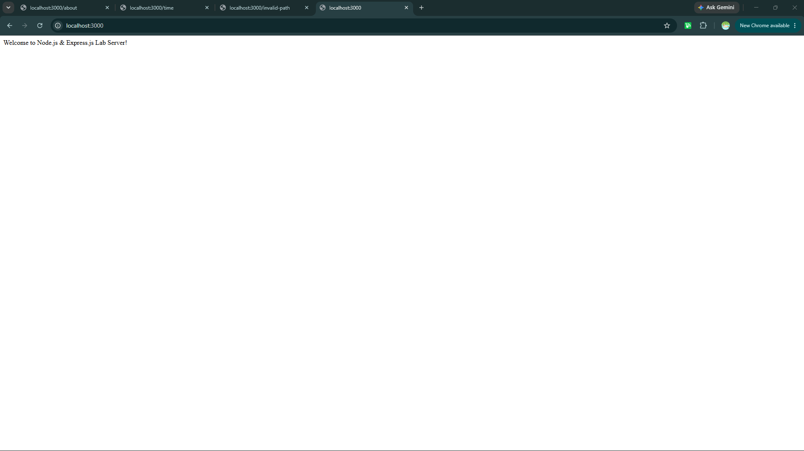
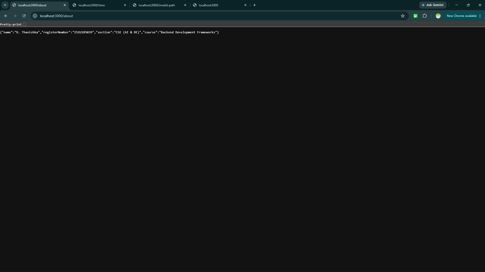
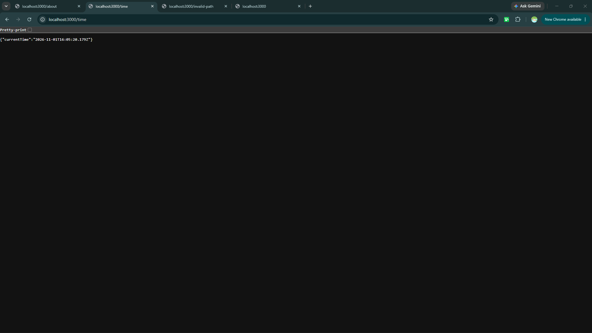
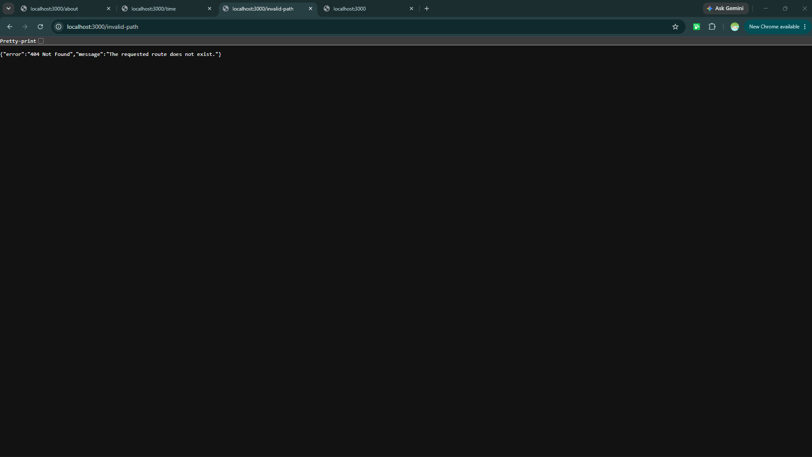

# Lab 01: Introduction to Express.js & Route Creation

Deployment URL:https://thanishka-lab-1.onrender.com

## Student Identity
- **Student Name:** D. Thanishka
- **Registration Number:** 252U1R5039
- **Section:** CSE (AI & DE)
- **Course:** Backend Development Frameworks

---

## 1. Objective
To set up a Node.js project and build a small web server using the built-in HTTP module, then create a web server using Express.js.

---

## 2. Project Description
This project demonstrates how to create a basic web server using Node.js and its built-in HTTP module and how to create a web server using Express.js.

The Express server provides three routes: /, /about, and /time. It also returns a 404 response for unknown routes.

---

## 3. Technologies Used
Node.js
Express.js
JavaScript
npm

---

## 4. Project Structure

```text
Thanishka-BDF/
└── lab-01/
    ├── node_modules/
    ├── screenshots/
    │   ├── home.png
    │   ├── about.png
    │   ├── time.png
    │   └── unknown.png
    ├── .gitignore
    ├── package.json
    ├── package-lock.json
    ├── README.md
    └── server.js
```
## Explanation of package.json
The package.json file stores information about the Node.js project and its dependencies.

name: Specifies the project name.
version: Specifies the current project version.
description: Provides a short description of the project, if present.
main: Specifies the main entry file, if present.
scripts: Defines commands that can be executed using npm.
author: Specifies the project author, if present.
license: Specifies the project's license, if present.
dependencies: Lists packages required by the application, such as Express.js.
devDependencies: Lists packages used during development, if present.
Only fields present in the actual package.json file apply to this project.

The package-lock.json file records the exact dependency versions used for installation. The node_modules folder contains the installed packages.
## Installation
## Prerequisites

- **Node.js** installed on the computer.
- **npm** (Node Package Manager), which is installed automatically with Node.js.

---

## Getting Started & Running Locally

1. **Clone the Repository:**
   ```bash
   git clone [https://github.com/dontaraboinathanishka/Thanishka-BDF.git](https://github.com/dontaraboinathanishka/Thanishka-BDF.git)
   cd Thanishka-BDF/lab-01
Install Dependencies:

Bash


npm install

Run the Server:

Development Mode (with auto-restart via Nodemon):

Bash


npm run dev
Standard Mode:

Bash


node server.js

## 5. API Endpoints
Local Base URL: http://localhost:3000

Live Base URL: https://thanishka-lab-1.onrender.com

The following endpoints are provided by the Express server.

Method Endpoint Description Expected Status GET / Returns a welcome message. 200 OK GET /about Returns JSON containing student name (Thanishka), registration number (252U1R5039), and section (CSE (AI & DE)). 200 OK GET /time Returns the current date and time using new Date().toISOString(). 200 OK GET Any unknown path Returns a 404 Page Not Found JSON payload. 404 Not Found

HTTP Method	Endpoint	Description
GET	/	Returns welcome message
GET	/about	Returns student identity details in JSON format
GET	/time	Returns current server timestamp in JSON format
GET	/* (Invalid Path)	Returns custom 404 Error message in JSON format

## 6. Screenshots

### GET / - Home Route


### GET /about - About Route


### GET /time - Time Route


### GET /invalid-path - 404 Error Route


## 7. Execution & Running Locally
Clone the repository:

Bash


git clone dontaraboinathanishka/Thanishka-BDF
cd Thanishka-BDF/lab-01
Install dependencies:

Bash


npm install
Start the development server with Nodemon:

Bash


npm run dev
Access endpoints in your browser:
Navigate to http://localhost:3000/.

## 8. Deployment
The application is deployed live on Render:

Deployment Platform: Render

GitHub Repository: dontaraboinathanishka/Thanishka-BDF

Live Base URL: https://thanishka-lab-1.onrender.com


---
## Testing
The endpoints should be tested by opening their URLs in a web browser.

The following checks should be performed:

Open / and check that the welcome message is displayed with status code 200.

Open /about and check that the student's name, registration number, and section are returned as JSON with status code 200.

Open /time and check that the current date and time are displayed with status code 200.

Open an unknown route, such as /unknown, and check that the server returns status code 404.

The screenshots in the screenshots/ folder provide evidence of the endpoint responses.

## Notes: Problems Faced and Solutions
GitHub upload: I learned how to stage, commit, and push the project files to GitHub using Git commands.

Node modules: I added node_modules/ to .gitignore to prevent uploading installed dependencies to GitHub. Dependencies can be installed again using npm install.

Deployment: I configured the Node.js project for deployment on Render and obtained a public deployment URL.

Testing: I used a web browser to check the server responses and verify the expected endpoints.

## Important Notes
Install dependencies using npm install.

Do not upload the node_modules/ folder to GitHub.

Do not commit or share any .env file containing secrets.

The basic HTTP server and Express server both use port 3000, so run them one at a time.

Ensure all screenshot files exist in the screenshots/ folder.

Verify the endpoint responses and status codes before submission.