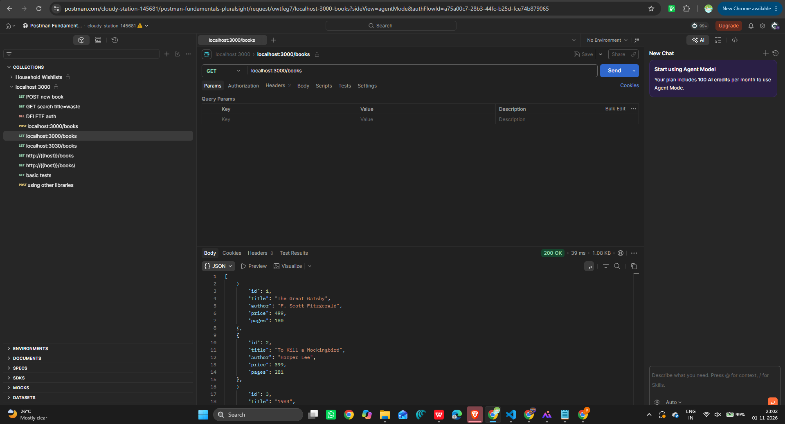
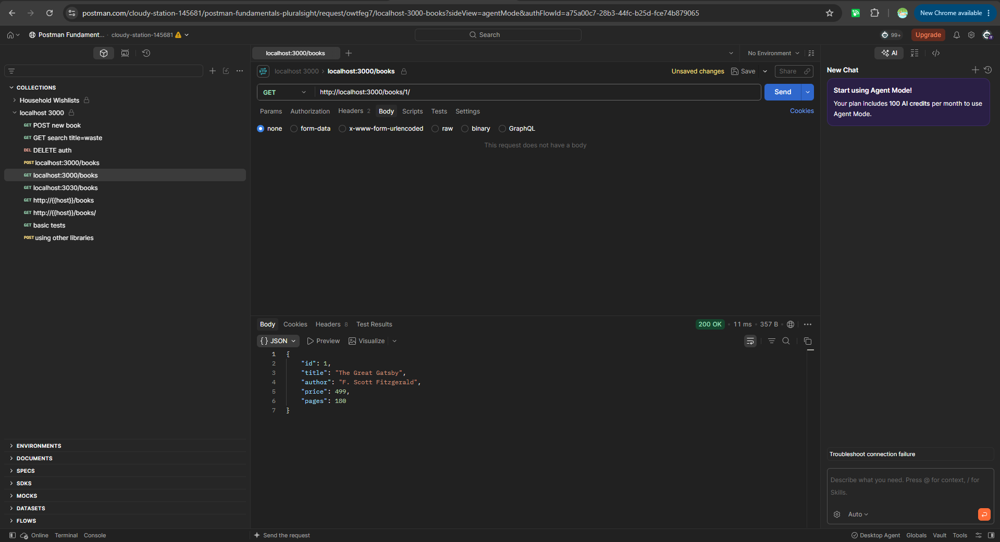
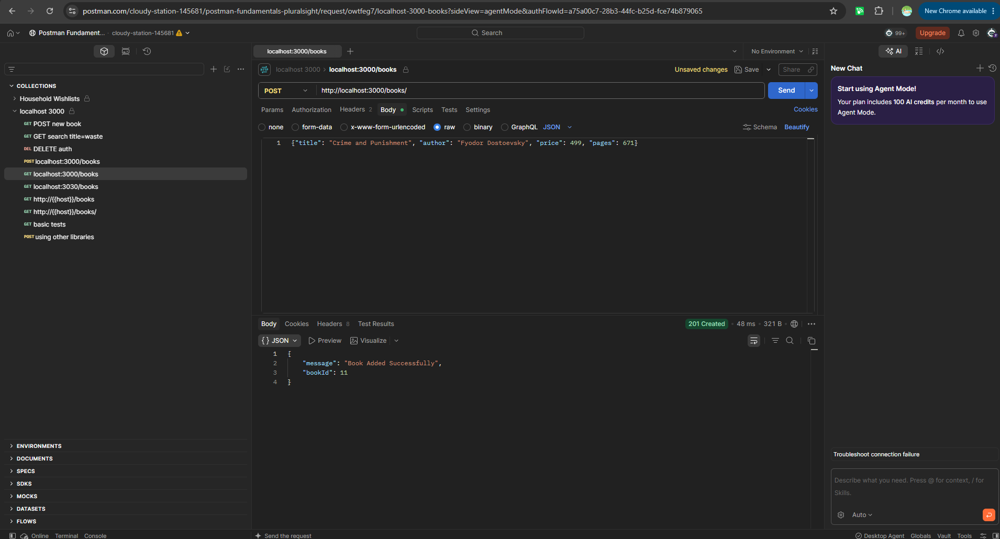
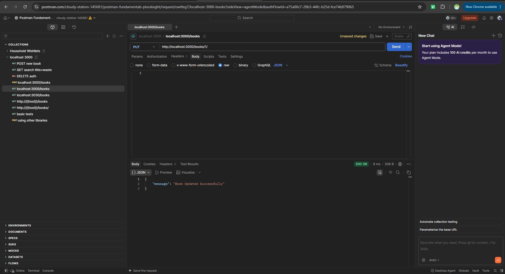
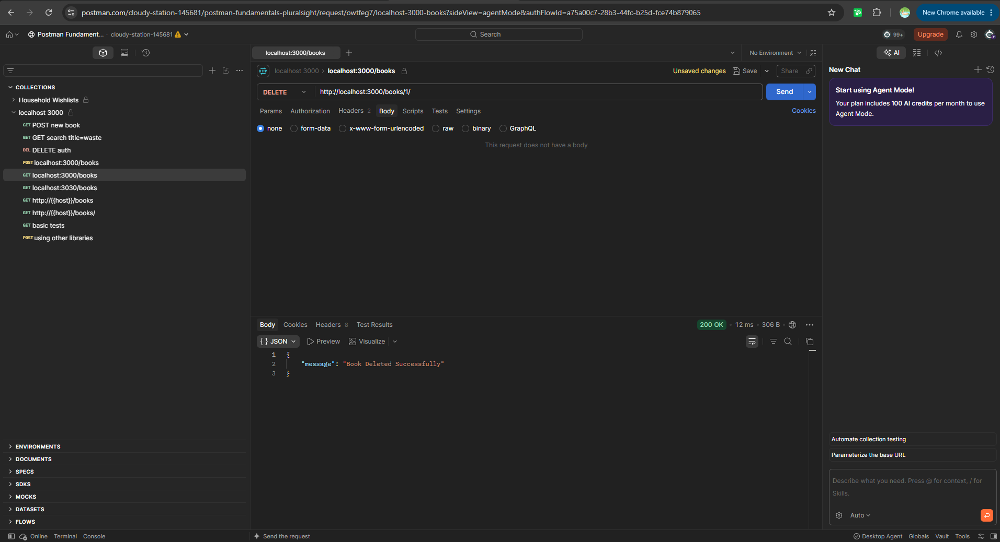

### Backend Development Lab 2 – SQLite Database and CRUD Operations
Live Link
Public Deployment URL: https://thanishka-lab-2.onrender.com
## Student Details
Name: D.THANISHKA
Registration Number: 252U1R5039
Section: CSE (AI & DE)
Course: Backend Development Fundamentals
Lab: Lab 2 – SQLite database and CRUD routes
## Objective 
The objective of this lab is to connect an Express.js server with an SQLite database and implement CRUD (Create, Read, Update, Delete) operations using REST API endpoints.
## Technologies Used
Backend Runtime: Node.js
Framework: Express.js
Database: SQLite3 / sqlite (Promise-based wrapper)
Development Tooling: Nodemon
API Testing: Postman
Version Control: Git & GitHub
Deployment Platform: Render
## 3. Project Structure
lab-02/ ├── .gitignore ├── goodreads.db ├── package.json ├── README.md ├── server.js └── screenshots/ ├── add-book.png ├── delete-book.png ├── get-all-books.png ├── get-data.png ├── get-single-book.png └── update-book.png

## 4. Database Details
Database Name: goodreads.db

Table Name: book

Column Data Type id INTEGER PRIMARY KEY title TEXT author TEXT price INTEGER pages INTEGER The database stores information about books, including their ID, title, author, price and number of pages.

Current Database Records The following records were verified in the local SQLite database after performing CRUD operations.

ID Book Title Author Price Pages 1 To Kill a Mockingbird Harper Lee 499 281 2 1984 George Orwell 399 328 3 The Great Gatsby F. Scott Fitzgerald 299 180 4 Pride and Prejudice Jane Austen 350 279 5 The Catcher in the Rye J.D. Salinger 450 234 6 The Hobbit J.R.R. Tolkien 599 310 7 Fahrenheit 451 Ray Bradbury 320 256 8 Jane Eyre Charlotte Brontë 380 500 9 Animal Farm George Orwell 250 112 10 Brave New World Aldous Huxley 420 288

## 5. CRUD Operations Performed
During testing, I performed the following operations:

DELETE: Deleted the book record with ID 1. POST: Added a new book named Clean Code with ID 11. PUT: Updated the details of an existing book. INSERT: Added The Alchemist again with ID 1 directly into the local SQLite database. These operations helped me understand how records are created, retrieved, updated and deleted.

## 6. Installation and Setup
Install Dependencies npm install Install Nodemon npm install --save-dev nodemon Run the Application For development:

npm run dev For normal execution:

npm start The local server runs on port 3000.

## 7.Screenshots

### 1. GET /books/ (Retrieve All Books)

### 2. GET /books/:bookId/ (Retrieve Single Book)

### 3. POST /books/ (Add New Book)

### 4. PUT /books/:bookId/ (Update Book)

### 5. DELETE /books/:bookId/ (Delete Book)

## 8. API Endpoints
Local Base URL:

http://localhost:3000 Live Base URL:

https://thanishka-lab-2.onrender.com

HTTP Method Endpoint Description GET /books/ Retrieve all books GET /books/:bookId/ Retrieve a book by ID POST /books/ Add a new book PUT /books/:bookId/ Update an existing book DELETE /books/:bookId/ Delete a book

## 9. API Request Examples
8.1 GET - Retrieve All Books GET /books/ Retrieves all book records from the database.

8.2 GET - Retrieve a Book by ID GET /books/1/ Retrieves a specific book using its ID.

8.3 POST - Add a New Book POST /books/ Request Body:

{ "title": "Dune", "author": "Frank Herbert", "price": 550, "pages": 412 } Adds a new book to the database.

8.4 PUT - Update a Book PUT /books/1/ Request Body:

{ "title": "To Kill a Mockingbird", "author": "Harper Lee", "price": 520, "pages": 281 } Updates the details of an existing book.

8.5 DELETE - Delete a Book DELETE /books/1/ Deletes a book using its ID.

## 10. SQL Queries Used
SELECT:

SELECT * FROM book; INSERT:

INSERT INTO book (title, author, price, pages) VALUES (?, ?, ?, ?); UPDATE:

UPDATE book SET title = ?, author = ?, price = ?, pages = ? WHERE id = ?; DELETE:

DELETE FROM book WHERE id = ?; Parameterized queries are used to safely pass values into SQL statements.

## 11. Testing
The API endpoints were tested using Postman.

GET - Retrieved all book records. GET by ID - Retrieved individual book details. POST - Added a new book successfully. PUT - Updated existing book details. DELETE - Deleted a book successfully. The database records were also verified using SQLite CLI. The database records were also verified using SQLite CLI.

## 12. Deployment
The Express.js application was deployed using Render.

Live API:

https://thanishka-lab-2.onrender.com

## 13. Problems Faced and Solutions
SQLite installation: Installed SQLite tools and configured the environment. Database connection: Connected SQLite with Express using the sqlite and sqlite3 packages. GitHub push rejection: Resolved unrelated Git histories and successfully pushed the project. Render compatibility: Addressed Node.js and SQLite package compatibility issues. API testing: Tested CRUD operations locally before deploying the updated application.